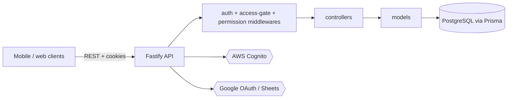

# UDV Sustentabilidade API

Backend for a mobile and web app that records ritual-supply data (sessions, plant material, preparations) per local nucleus and region, with role-based visibility driven by an external identity provider.

**Status:** deployed for a private client; source kept private. The repository is a snapshot of ongoing work and is not presented as a product with public users.

## What it does

- Sign-in against AWS Cognito, with local sign-up and a pending-access state for users without a qualifying role (`src/api/v1/services/authentication`).
- Access gate and permission derivation from Cognito claims (role, grade, bypass list): `src/api/v1/services/authorization`, `src/middlewares`.
- Nucleus and region provisioning from the token on login, scoped data visibility (own nucleus vs regional).
- CRUD and listing for sessions, plant material (vegetal, chacrona, lenha), preparations and "mariri" records.
- Google OAuth and Google Sheets integration for spreadsheet import/export (`src/routes/oauth-route.ts`, `sheets-route.ts`).
- JWT in HTTP-only cookies with refresh, rate limiting, Swagger UI.
- Health probe at `/health`.

## Architecture



- Routes live in `src/routes`, handlers in `src/api/v1/controllers`, data access in `src/api/v1/models`, business rules in `src/api/v1/services`.
- Cognito is the identity source; local rows (users, nuclei, regions, permissions) are provisioned on login.
- Env is validated with zod at boot (`src/env/index.ts`).

## Key engineering decisions

- Permissions are derived automatically from the user's role on every login, with no manual assignment: `src/api/v1/services/authorization/derive-access.ts`.
- A dedicated access gate rejects or defers users without a qualifying role: `src/middlewares/acesso-liberado-middleware.ts`, with route-level tests in `src/routes/acesso-liberado-gate.test.ts`.
- Dev-only claim mocking restricted to bypass emails to test role scenarios without the identity provider: `src/api/v1/services/authentication/apply-mock-claims.ts`.
- Design notes and plans are kept in `docs/superpowers/` (in Portuguese).
- Both `package-lock.json` and `yarn.lock` are tracked; use npm.

## Tech stack

Node, TypeScript, Fastify 5, zod, Prisma 6 (PostgreSQL), AWS Cognito SDK, @fastify/jwt, googleapis, Vitest, Biome, Docker.

## Getting started

Prerequisites: Node 22+, PostgreSQL (or `docker compose`), a Cognito user pool and Google OAuth client.

```bash
cp .env.example .env     # fill placeholders
npm install
npx prisma generate
npx prisma migrate deploy   # or db push for a scratch database
npm run db:seed:perms
npm run dev
```

| Variable | Purpose |
|---|---|
| `PORT`, `ENVIRONMENT` | Listen port; development or production |
| `DATABASE_URL` | PostgreSQL connection string |
| `JWT_PRIVATE_KEY`, `JWT_PUBLIC_KEY` | Base64 RS256 key pair |
| `GOOGLE_CLIENT_ID`, `GOOGLE_CLIENT_SECRET`, `REDIRECT_URI`, `EXPO_SCHEME` | Google OAuth and mobile redirect |
| `COGNITO_REGION`, `COGNITO_USER_POOL_ID`, `COGNITO_USER_POOL_CLIENT_ID` | Cognito pool |
| `BYPASS_EMAILS`, `MOCK_*` | Optional dev-only access bypass and claim mocking |
| `POSTGRES_*` | Used by `docker-compose.yml` only |

## Testing

`npm test` runs Vitest: 9 test files, 52 tests (auth service, Cognito, sign-up, access gate, error handler), all passing at the time of writing.

## Project structure

```text
prisma/        schema, seeds, backfill
src/api/v1/    controllers, models, services
src/routes/    route registration
src/middlewares/  auth, access gate, permissions
src/env/       validated environment
docs/          design specs and plans
```

## Related repositories

- [udv-sus-web](https://github.com/mkwitko/udv-sus-web): web client
- [udv-sus-mobile](https://github.com/mkwitko/udv-sus-mobile): mobile client

## License

All rights reserved. Source available for portfolio review.
